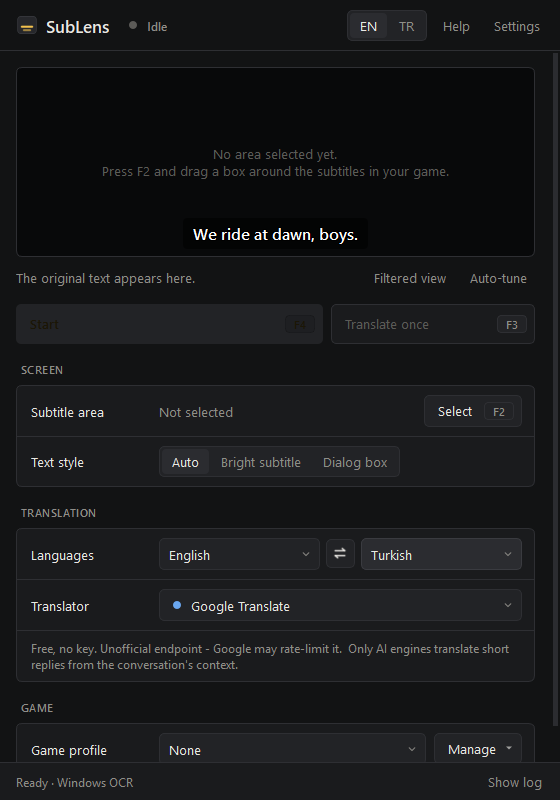

# SubLens

Reads subtitles and dialogue from any part of your screen and shows a live translation on top of your game. Windows 10/11.

<p align="center">
  
</p>

> **Türkçe:** [READMEtr.md](READMEtr.md)

<p align="center">
  
</p>

---

## Download

Get `SubLens.exe` from [Releases](https://github.com/bnsware/SubLens/releases/latest) and run it. There is nothing to install.

The exe is built with PyInstaller and is not code-signed, so Windows SmartScreen or some antivirus engines may warn about it. You can also [run it from source](#run-from-source).

## Quick start

1. Press **F2** and draw a box around the subtitles in your game. For two-line subtitles, cover both lines.
2. Choose the languages and a translator. Google Translate needs no setup.
3. Press **F4** and switch to your game.

If the text reads badly, press **Auto-tune** while a subtitle is on screen.

SubLens reads text with Windows OCR, so the source language's OCR pack must be installed. If it's missing, the app tells you and gives you the command to install it.

## Features

**Reading**
- Windows OCR, built into Windows 10/11. No separate OCR program is needed.
- Three text styles: Auto, Bright subtitle and Dialog box. Auto-tune picks the best reading settings for you.
- Wrapped lines are joined into one sentence, and each speaker tag starts a new paragraph.
- Button icons, symbols and small UI hints are filtered out.
- Half-faded text that reads as noise waits until it is legible. If a misread was already translated, a clean read replaces it.
- Damaged speaker labels are repaired ("eter:" or "Peter." becomes "Peter:").
- Scrolling captions (YouTube, streams) are followed as one stream, so lines aren't translated twice.

**Translation**

| Engine | Setup | Notes |
|---|---|---|
| Google Translate | None | Free, but an unofficial endpoint that may be rate-limited |
| DeepL | API key (free plan available) | Uses previous lines as context |
| AI (OpenAI-compatible) | LM Studio or Ollama (local), or an OpenAI, OpenRouter or Groq key | Uses conversation context, game context and the glossary |
| Claude | Anthropic API key | Same context features as above |
| Gemini | Google AI Studio key | Same context features as above |

- AI engines get the previous lines with their translations, so short replies come out right: after "You should try this.", the Turkish "Neyi?" becomes "Try what?" rather than "What?".
- Glossary: keep names untranslated or force a rendering.
- Game profiles: area, language, reading settings, context and glossary per game, loaded automatically when bound to the game's exe.

**Overlay and app**
- A draggable overlay sized to the subtitle. It is hidden from screen capture, so it never reads itself back.
- Font size, opacity, position and click-through settings.
- English and Turkish interface.
- Global hotkeys, auto-pause when the game loses focus, and a tray icon with optional notifications.

## Hotkeys

| Key | Global alternative | Action |
|---|---|---|
| F2 | Ctrl+Alt+R | Select area |
| F3 | Ctrl+Alt+T | Translate once |
| F4 | Ctrl+Alt+G | Start / stop |
| Esc | Ctrl+Alt+H | Hide overlay |

Global hotkeys also work in fullscreen games. If the game runs as administrator, run SubLens as administrator too. Hotkeys can't be remapped yet. If your keyboard has no F keys, use the Ctrl+Alt shortcuts or the buttons in the window.

## Run from source

Tested on Python 3.13.

```bat
git clone https://github.com/bnsware/SubLens.git
cd SubLens
sublens.bat
```

`sublens.bat` creates a virtual environment, installs the dependencies and starts the app. To do it by hand:

```bat
pip install -r requirements.txt
python main.py
```

Run the tests with `python -m unittest discover tests`.

## Build the exe

```bat
sublens_exe.bat
```

The result is `dist\SubLens.exe`.

## Troubleshooting

| Symptom | Fix |
|---|---|
| "Windows OCR has no '…' language pack" | Windows Settings > Time & language > Language > add the language, with "Optical character recognition" ticked. |
| "The text doesn't look like …" | The source language is wrong. |
| Garbled text | Use **Auto-tune** with a subtitle on screen. Otherwise try **Bright subtitle** and fit the area tightly around the subtitle. |
| Speaker names lose their first letters | The area cuts the name off. Widen it a little to the left. |
| Translations lag | Google and DeepL are faster than local models. |
| Hotkeys don't work in game | Run SubLens as administrator. |
| Overlay won't drag | Turn off click-through under Settings > Overlay. |

Settings are stored in `%APPDATA%\SubLens\config.json`. Delete the file to reset them. Settings from v1 are migrated automatically.

## Project layout

```
SubLens/
├── main.py              Entry point
├── sublens/
│   ├── ocr.py           Windows OCR and image filters
│   ├── textproc.py      Icon filter, line joining, speaker labels, glossary
│   ├── pipeline.py      Scanning and translation threads
│   ├── engines/         Translation engines
│   └── ui/              Interface
├── tests/
├── _build.py            PyInstaller build
├── sublens.bat          Run from source
├── sublens_exe.bat      Build the exe
└── READMEapp*.md        In-app help
```

The original single-file version is available under the [`1.0` tag](https://github.com/bnsware/SubLens/tree/1.0).

## License

[MIT](LICENSE)
