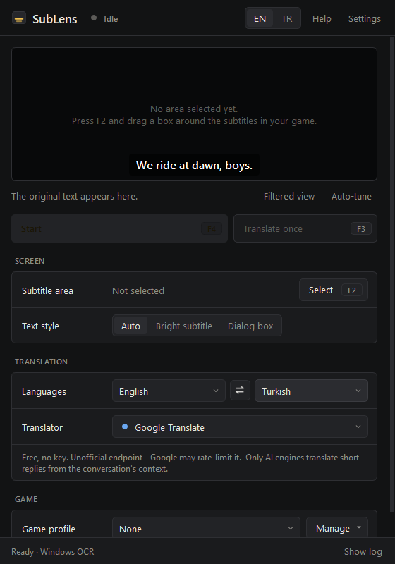

# SubLens

Ekranın istediğin bölümündeki altyazı ve diyalogları okur, çevirisini anında oyunun üstünde gösterir. Windows 10/11.

<p align="center">
  
</p>

> **English:** [README.md](README.md)

<p align="center">
  
</p>

---

## İndirme

[Releases](https://github.com/bnsware/SubLens/releases/latest) sayfasından `SubLens.exe` dosyasını indirip çalıştır. Kurulum gerekmez.

Exe, PyInstaller ile derlenmiştir ve kod imzası yoktur. Bu yüzden Windows SmartScreen ya da bazı antivirüs motorları uyarı verebilir. İstersen [kaynak koddan da çalıştırabilirsin](#kaynak-koddan-çalıştırma).

## Hızlı başlangıç

1. **F2**'ye bas ve oyundaki altyazının etrafına kutu çiz. İki satırlık altyazılarda iki satırı da kapsa.
2. Dilleri ve çevirmeni seç. Google Translate kurulum gerektirmez.
3. **F4**'e bas ve oyuna geç.

Metin kötü okunuyorsa ekranda altyazı varken **Otomatik ayarla** düğmesine bas.

SubLens metni Windows OCR ile okur, bu yüzden kaynak dilin OCR paketi kurulu olmalıdır. Paket eksikse uygulama bunu söyler ve kurulum komutunu verir.

## Özellikler

**Okuma**
- Windows 10/11'de yerleşik Windows OCR kullanılır. Ayrı bir OCR programı gerekmez.
- Üç metin stili vardır: Otomatik, Parlak altyazı ve Diyalog kutusu. Otomatik ayarla en iyi okuma ayarlarını kendisi seçer.
- Alt alta gelen satırlar tek cümle olarak birleştirilir, her konuşmacı etiketi yeni paragraf başlatır.
- Tuş ikonları, semboller ve küçük arayüz ipuçları ayıklanır.
- Yarı saydamken bozuk okunan metin, okunaklı hale gelene kadar bekletilir. Bozuk okuma çevrildiyse temiz okuma onun yerine geçer.
- Bozuk konuşmacı etiketleri düzeltilir ("eter:" ya da "Peter." → "Peter:").
- Kayan altyazılar (YouTube, yayınlar) tek akış olarak izlenir, böylece satırlar iki kez çevrilmez.

**Çeviri**

| Motor | Kurulum | Not |
|---|---|---|
| Google Translate | Yok | Ücretsiz ama gayri resmi uç nokta olduğu için sınırlanabilir |
| DeepL | API anahtarı (ücretsiz planı var) | Önceki satırları bağlam olarak kullanır |
| AI (OpenAI uyumlu) | LM Studio ya da Ollama (yerel) veya OpenAI, OpenRouter, Groq anahtarı | Konuşma bağlamını, oyun bağlamını ve sözlüğü kullanır |
| Claude | Anthropic API anahtarı | Bağlam özellikleri yukarıdakiyle aynı |
| Gemini | Google AI Studio anahtarı | Bağlam özellikleri yukarıdakiyle aynı |

- AI motorlarına önceki satırlar çevirileriyle birlikte gider, bu yüzden kısa cevaplar doğru çevrilir: "Bunu denemelisin." cümlesinden sonra gelen "Neyi?", "What?" değil "Try what?" olur.
- Sözlük: adları çevirmeden bırakabilir ya da belirli bir karşılığı zorlayabilirsin.
- Oyun profilleri: alan, dil, okuma ayarları, bağlam ve sözlük oyun bazında saklanır. Oyunun exe'sine bağlanırsa kendiliğinden yüklenir.

**Çeviri katmanı ve uygulama**
- Altyazıya göre boyutlanan, sürüklenebilir bir katman. Ekran yakalamaya görünmez, bu yüzden kendi çevirisini tekrar okumaz.
- Yazı boyutu, saydamlık, konum ve tıklamaların oyuna geçmesi ayarları.
- Türkçe ve İngilizce arayüz.
- Global kısayollar, oyun öne çıkmadığında otomatik duraklama ve kapatılabilir bildirimli sistem tepsisi simgesi.

## Kısayollar

| Tuş | Global alternatif | İşlev |
|---|---|---|
| F2 | Ctrl+Alt+R | Alan seç |
| F3 | Ctrl+Alt+T | Tek seferlik çeviri |
| F4 | Ctrl+Alt+G | Başlat / durdur |
| Esc | Ctrl+Alt+H | Çeviri katmanını gizle |

Global kısayollar tam ekran oyunlarda da çalışır. Oyun yönetici olarak çalışıyorsa SubLens'i de yönetici olarak aç. Kısayollar henüz değiştirilemiyor. Klavyende F tuşları yoksa Ctrl+Alt kısayollarını ya da penceredeki düğmeleri kullan.

## Kaynak koddan çalıştırma

Python 3.13 ile test edildi.

```bat
git clone https://github.com/bnsware/SubLens.git
cd SubLens
sublens.bat
```

`sublens.bat` sanal ortamı oluşturur, bağımlılıkları kurar ve uygulamayı başlatır. Elle yapmak için:

```bat
pip install -r requirements.txt
python main.py
```

Testleri `python -m unittest discover tests` ile çalıştırabilirsin.

## Exe derleme

```bat
sublens_exe.bat
```

Sonuç `dist\SubLens.exe` dosyasıdır.

## Sorun giderme

| Belirti | Çözüm |
|---|---|
| "Windows OCR'da '…' dil paketi yok" | Windows Ayarları > Saat ve dil > Dil > dili ekle ("Optik karakter tanıma" işaretli olsun). |
| "Metin … gibi görünmüyor" | Kaynak dil yanlış seçilmiş. |
| Metin bozuk okunuyor | Altyazı ekrandayken **Otomatik ayarla**'yı kullan. Olmazsa **Parlak altyazı**'yı dene ve alanı altyazıya göre daralt. |
| Konuşmacı adının ilk harfleri eksik | Alan adı kesiyor. Alanı soldan biraz genişlet. |
| Çeviri gecikiyor | Google ve DeepL yerel modellerden hızlıdır. |
| Kısayollar oyunda çalışmıyor | SubLens'i yönetici olarak çalıştır. |
| Çeviri katmanı sürüklenmiyor | Ayarlar > Çeviri katmanı bölümünden tıklamaların oyuna geçmesini kapat. |

Ayarlar `%APPDATA%\SubLens\config.json` dosyasında tutulur. Sıfırlamak için dosyayı silmen yeterli. v1 ayarları otomatik taşınır.

## Proje düzeni

```
SubLens/
├── main.py              Giriş noktası
├── sublens/
│   ├── ocr.py           Windows OCR ve görüntü filtreleri
│   ├── textproc.py      İkon filtresi, satır birleştirme, konuşmacı etiketleri, sözlük
│   ├── pipeline.py      Tarama ve çeviri thread'leri
│   ├── engines/         Çeviri motorları
│   └── ui/              Arayüz
├── tests/
├── _build.py            PyInstaller derlemesi
├── sublens.bat          Kaynak koddan çalıştırma
├── sublens_exe.bat      Exe derleme
└── READMEapp*.md        Uygulama içi yardım
```

İlk tek dosyalık sürüm [`1.0` etiketinde](https://github.com/bnsware/SubLens/tree/1.0) duruyor.

## Lisans

[MIT](LICENSE)
